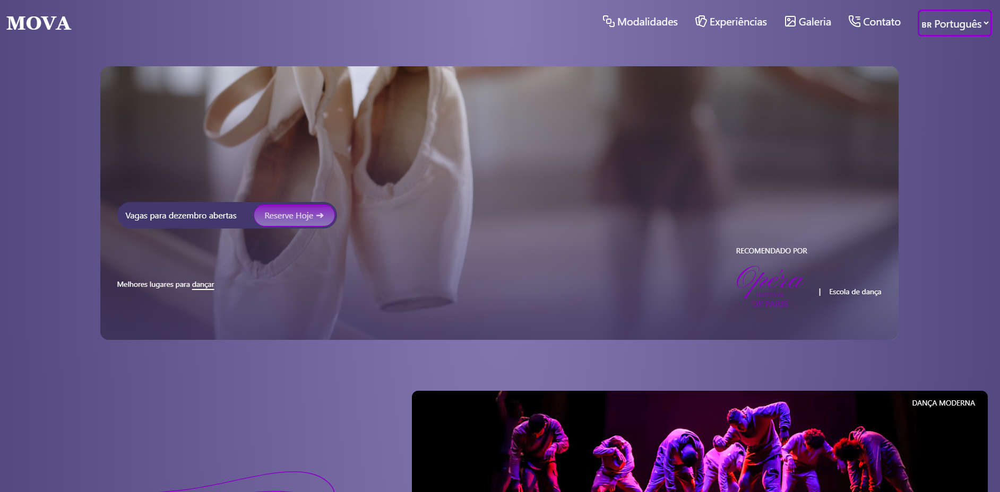

# 💃 MOVA — Studio de Dança

Landing page desenvolvida para um estúdio de dança fictício, com o objetivo de praticar e aprimorar conhecimentos em **React** e **Tailwind CSS**.

O projeto foi desenvolvido após a conclusão do curso de Tailwind CSS da Origamid, colocando em prática os conceitos estudados durante as aulas, com foco na construção de interfaces modernas, criativas e responsivas.

## ✨ Sobre o projeto

O MOVA é uma landing page conceitual para um estúdio de dança, criada para apresentar sua identidade visual, modalidades de dança e proposta artística.

O desenvolvimento teve como foco a construção da interface, explorando recursos de estilização do Tailwind CSS e a componentização com React.

## 🚀 Tecnologias utilizadas

- **React** — construção da interface e componentização.
- **Tailwind CSS** — estilização e criação do layout.
- **JavaScript** — lógica e interatividade da interface.
- **Vite** — ferramenta de desenvolvimento e build.

## 🖥️ Demonstração

Acesse o projeto publicado:

[MOVA — Studio de Dança](https://estefane-ribeiro.github.io/Mova/)

## 📸 Preview



## ⚙️ Como executar o projeto

1. Clone este repositório:

   ```bash
   git clone https://github.com/estefane-ribeiro/Mova.git
   ```

2. Acesse a pasta do projeto:

   ```bash
   cd Mova
   ```

3. Instale as dependências:

   ```bash
   npm install
   ```

4. Inicie o servidor de desenvolvimento:

   ```bash
   npm run dev
   ```

5. Acesse o endereço disponibilizado pelo Vite no terminal.

## 🎯 Objetivo de aprendizado

Este projeto foi desenvolvido como exercício prático após o curso de Tailwind CSS da Origamid, com o propósito de consolidar conhecimentos em:

- Desenvolvimento de interfaces com React.
- Estilização utilizando Tailwind CSS.
- Organização e reutilização de componentes.
- Construção de layouts e interfaces responsivas.

## 👩‍💻 Autoria

Desenvolvido por **Estefane Ribeiro**.

[GitHub](https://github.com/estefane-ribeiro)
